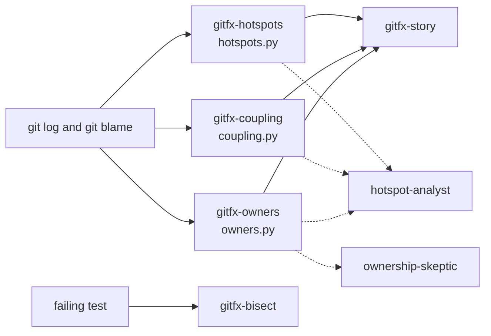

# git-forensics-skill

**Your git log already knows where the bugs are.**


Every codebase has a few files that are painful: big, tangled and edited every week. Everyone on
the team can name two or three of them, and nobody can say which are the worst, what secretly
changes along with them, or who understands them. The answer is already in version control, in the
record of what was changed, with what, and by whom.

This Claude Code pack reads that record. Three standard-library Python scripts stream `git log`
and `git blame` and print only what matters: files ranked by how often they change times how
heavy they are, pairs of files that keep changing in the same commit without referencing each
other, and who holds the knowledge of each part of the code and whether they are still around.
Five skills drive them, and two read-only agents check the work. In the spirit of "Your Code as a
Crime Scene", but small, local and honest about its limits.

Everything runs on your machine. The scripts only run read-only git commands (`log`, `blame`,
`ls-files`, `rev-parse`), make no network calls and never write to your repository. Memory use
follows the number of files, not the length of the history.

## What's inside

| Skill | What it does |
|---|---|
| [`gitfx-hotspots`](skills/gitfx-hotspots/SKILL.md) | `hotspots.py`: churn times size and nesting per file, with commits, lines, authors and fix share. Explains each hotspot and where tests or refactoring pay off. |
| [`gitfx-coupling`](skills/gitfx-coupling/SKILL.md) | `coupling.py`: temporal coupling with support and confidence both ways. Flags cross-module pairs with no visible reference, separates test pairs, groups clusters. |
| [`gitfx-owners`](skills/gitfx-owners/SKILL.md) | `owners.py`: author share by surviving lines (blame) or commits, bus factor per file, directory and repository, knowledge at risk, alias merging, bots left out. |
| [`gitfx-story`](skills/gitfx-story/SKILL.md) | No script of its own. Runs the three scripts from their sibling skill folders and writes a one-page "state of this codebase" with five suggested first reads. |
| [`gitfx-bisect`](skills/gitfx-bisect/SKILL.md) | No script. A disciplined `git bisect`: deterministic test first, `git bisect run`, skips, flaky tests, and a recorded culprit. |

| Agent | What it does |
|---|---|
| [`hotspot-analyst`](agents/hotspot-analyst.md) | Reads the three reports and the code of the top files, returns a prioritised refactor and test plan with evidence. |
| [`ownership-skeptic`](agents/ownership-skeptic.md) | Challenges ownership conclusions: bot commits, squash merges, mass reformats, vendor drops, unmerged aliases. |

Each analysis skill folder stands alone. The exception is `gitfx-story`, which calls the scripts
of its sibling skills (`../gitfx-hotspots/hotspots.py` and the other two), so install the whole
pack for it to work. The three scripts share one git-reading core that is copied between them;
a test checks that the copies are identical.

## Install

```
/plugin marketplace add vivekbhange-hub/git-forensics-skill
/plugin install git-forensics-skill@git-forensics-skill
```

Manual install: copy `skills/*` into `~/.claude/skills/` and `agents/*` into `~/.claude/agents/`.

Requirements: Python 3.9 or newer and `git` on the PATH. Nothing else.

## Try it in 60 seconds

The repo ships a generator for a synthetic history: a made-up shop with about 50 commits by
invented people (`example.com` addresses), fixed dates and a few planted problems. It is built
on demand into a git-ignored folder, so nothing in this repository is itself a git repository.
In Claude Code:

> Build the demo history with examples/regenerate.py, then tell me where examples/demo-repo is fragile and who knows it

Or run it yourself from the repo root (on Windows use `python` instead of `python3`):

```
python3 examples/regenerate.py --build-demo examples/demo-repo
python3 skills/gitfx-hotspots/hotspots.py examples/demo-repo --top 10
```

Excerpt of the output, copied from [`examples/output/hotspots.md`](examples/output/hotspots.md):

```output
| 1 | `src/shop/orders.py` | 100.0 | 19 | 244 | 51 | 4 | 193 | 6.0 | 3.02 | 52.6% | changes often, large and deeply nested, many fixes, many authors |
| 2 | `billing/invoice.py` | 90.4 | 14 | 77 | 19 | 4 | 58 | 2.0 | 1.5 | 50.0% | changes often, large and deeply nested, many fixes, many authors |
| 4 | `src/shop/legacy_sync.py` | 89.3 | 8 | 140 | 9 | 2 | 131 | 6.0 | 3.16 | 37.5% | changes often, large and deeply nested |
```

Ten of the 19 commits to `orders.py` have a fix-like subject, which is why it is not just a busy
file. `package-lock.json` and the vendored `lib.js` also changed a lot, and are skipped by
default. Now what moves together:

```
python3 skills/gitfx-coupling/coupling.py examples/demo-repo --hidden-only --min-shared 4 --top 5
```

```output
| 1 | `billing/invoice.py` | `src/shop/orders.py` | 12 | 0.245 | 0.86 | 0.63 | yes | none seen | hidden dependency? |
| 3 | `docs/guide.md` | `src/shop/config.py` | 6 | 0.122 | 0.86 | 1.0 | yes | none seen | hidden dependency? |
```

Invoices and orders changed together 12 times, in different top-level directories, and neither
file mentions the other. That is a rule duplicated in two places. A 35-file reformat commit was
skipped as a bulk edit, otherwise it would have coupled every adapter to every other. Finally, who
knows what:

```
python3 skills/gitfx-owners/owners.py examples/demo-repo --as-of 2026-11-01 --top 8
```

```output
- Commits scanned: 51 (5 bot commits excluded); authors after merging aliases: 5
| `src/shop/legacy_sync.py` | Eli Former | 99.2% | 2026-03-10 | 236 | 8 | blame |
```

One person wrote 99 percent of the surviving lines of `legacy_sync.py` and has not committed
anywhere for 236 days. Ava Example's early commits used a second address; `.mailmap` merged
them, which is why there are five authors and not six. The bot's dependency bumps were left out.

`python3 examples/regenerate.py --check` rebuilds the history in a temporary folder and proves the
committed reports in [`examples/output/`](examples/output/) are exactly what the scripts produce
today. If `git` is not installed, the tests that need it skip with a message.

## How it works



1. **Stream.** `git log --no-merges -z --numstat -M` is read in chunks and split on NUL, so file
   names with spaces, accents or odd characters survive, and the history is never held in memory.
   Git is run with `LC_ALL=C` and `core.quotepath=off`.
2. **Follow renames.** Reading newest first, each rename git detects maps the old path onto the
   new one, so a file keeps its history after a move. Pure renames do not count as churn.
3. **Rank hotspots.** Churn is commits touching the file. Complexity is lines times
   (1 + mean indentation level). Each is turned into a percentile among the files in the window
   and multiplied, scaled 0 to 100. Fix share is the percentage of those commits whose subject
   matches fix, bug, hotfix, revert or regression.
4. **Count co-changes.** For each commit that touches 2 to `--max-files` files, every pair gets
   one count. Confidence A to B is shared commits over A's commits. Pairs are flagged cross-module
   when their top-level directories differ, as test pairs when one is the test of the other, and
   as hidden when no name reference is visible either way.
5. **Share ownership.** `git blame --line-porcelain -w` is streamed for the most-changed files
   and lines are credited to the author who last changed them. Elsewhere, and with `--fast`,
   commits are shared instead. Bus factor is the smallest number of authors reaching 50 percent.
   Knowledge at risk is a main owner (at least 50 percent) with no commit anywhere for
   `--inactive-days`.

## Responsible use

People analytics is easy to abuse. This pack is for repositories you own or are authorized to
analyse, and it is built to talk about code, not about people.

- Never use per-author numbers for performance reviews, rankings, bonuses or staffing decisions.
  Commits and surviving lines measure who typed, not who understands, mentors, reviews or
  prevents outages. The owners report says so in its own output.
- The pack reports file-level and team-level findings by default, and per-author names only in
  the ownership report. The hotspot and coupling reports contain no author names, and the story
  keeps names to its ownership section.
- Treat the ownership report like a staff list: share it with the people it concerns before it
  goes wider, and strip names for outside audiences.
- Bots are left out of ownership by default. Aliases are merged through `.mailmap` and
  `--merge-email-domain`; check the merge before you trust a count.
- History can hold personal data (names, email addresses). Nothing here makes a network call, but
  the reports you generate are yours to protect.

## Principles and limits

- **Evidence over narrative.** Each skill ends in a finding that points at report rows or code it
  opened, and says what it could not check.
- **History is a proxy.** Churn shows where change happened, not where the pain was; fix share
  reads commit subjects, so squash merges and subjects like "update" hide fixes.
- **Complexity is an indentation proxy**, not cyclomatic complexity. A long flat table looks
  simple and a file of tiny nested lambdas looks heavy. Read the file before acting.
- **Renames are followed only when git detects them** (about 50 percent similarity). A heavily
  edited move looks like a new file. A `--path` filter can hide one side of a rename.
- **Coupling is co-change, not dependency.** Squash merges glue unrelated files together; the
  reference check compares file name stems as text and is easily fooled. Pairs are leads.
- **Bulk commits are skipped** for coupling (more than `--max-files` files). Memory for pair
  counts grows with distinct pairs and is pruned past `--max-pairs`; the report says when so.
- **Blame is limited to the top files** (default 15) and has a per-file timeout; slower files
  fall back to commit share and are marked. Squash merges credit the merger, and mass reformats
  can capture lines unless the repo has a `.git-blame-ignore-revs`.
- **Idle is not gone.** An owner with no commits may be on leave or in another repository.
- **Shallow clones lie.** Fetch the full history before running anything.
- **Dates:** `--since 2026-02-05` means that day at the current time of day in git; pass
  `"2026-02-05 00:00:00 +0000"` for a whole day.
- **Platforms:** Python 3.9 or newer, git 2.23 or newer for `--ignore-revs`. The CI workflow runs
  the tests on Linux, Windows and macOS with Python 3.9, 3.12 and 3.13. The test suite also parses
  every script and test for Python 3.9 syntax, because 3.9 was not installed where the pack was
  developed (it was run on 3.12 and 3.13).

## Contributing

See [CONTRIBUTING.md](CONTRIBUTING.md). Run the tests with
`python -m unittest discover -s tests -v`.

## License

MIT © 2026 Vivek Bhange. See [LICENSE](LICENSE).
